  
  

## `01 // OPERATOR PROFILE`

> Information Technology undergraduate pursuing a **BSc (Hons) in Information Technology, specialising in Cyber Security**.

I'm passionate about **Blue Team operations, ethical hacking, network security and vulnerability assessment**. I keep sharpening my practical skills and am working towards a career as a **SOC Analyst / Cybersecurity Analyst**.

## `02 // SECURITY ARSENAL`

| Category | Skills & Tools |
|---|---|
| 🛡️ **Security Operations** | Vulnerability Assessment · Security Analysis · Wireshark |
| 🌐 **Network Security** | Cisco Packet Tracer · ACLs · Zone-Based Firewall · Port Security · RADIUS · TACACS+ · DHCP Snooping · Dynamic ARP Inspection · IPsec VPN |
| 🕵️ **Ethical Hacking** | Web Application Security Testing · Burp Suite · OWASP ZAP · ExifTool |
| ⚙️ **DevSecOps** | SAST · Secure Coding · Semgrep · Trivy · Gitleaks · npm audit · GitHub Actions · Docker |
| 💻 **Programming** | Python · JavaScript · Node.js · PostgreSQL · SQLite |
| 🧰 **Tools** | Git · GitHub · Docker |

  
  
  
  
  
  
  

## `03 // FEATURED MISSIONS`

<table>
<tr><td>

### 🚩 [Solstice CTF — Capture the Flag Platform](https://github.com/IT24104133/PT_CTF)
A cybersecurity CTF platform with hands-on challenges in web application security — **SQL injection, XXE, XSS, IDOR** — and **digital forensics**.

`Node.js` `JavaScript` `SQLite` `Burp Suite` `ExifTool` `Git` `GitHub` `Render`

</td></tr>
</table>

**Other work:** NodeGoat DevSecOps security pipeline · Cisco Packet Tracer network security implementation · Concurrent server development

## `04 // OPERATIONAL FOCUS`

| Hands-on experience | Currently learning / interested in |
|---|---|
| Vulnerability assessment & web app testing | SOC operations & security monitoring |
| Network defence in Cisco Packet Tracer | Threat detection |
| SAST & DevSecOps pipelines | Incident response |
| CTF challenge building | Digital forensics · AI-powered cybersecurity |

## `05 // GITHUB ACTIVITY`

  

## `06 // CONNECT`

  

  

