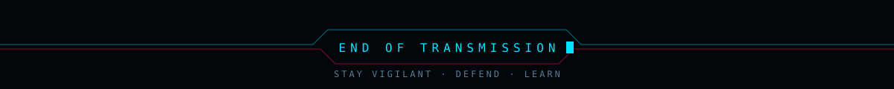

  

<h3 align="center">Securing systems. Investigating threats. Building resilient networks.</h3>

  
  

---

## `> whoami`

I'm **Vaaranan J**, a cybersecurity-focused IT undergraduate — BSc (Hons) in Information Technology specialising in Cyber Security — and an aspiring **SOC Analyst**. I focus on blue team defense, network security, threat detection and secure application development, and I build practical security projects that make complex defense concepts clear and usable.

Open to **internship and collaboration** opportunities.

  

## `> ./dashboard --profile`

> Profile focus areas. These are interests and learning areas, not live monitoring.

| 🛡️ Security Operations | 🎯 Threat Detection | 🌐 Network Security |
| :-- | :-- | :-- |
| SOC workflows and blue team defense | Detection and response fundamentals | Defensive architecture, segmentation, firewalls and ACLs |
| **🗡️ Ethical Hacking** | **🔍 Digital Forensics** | **📚 Learning & Research** |
| Vulnerability assessment fundamentals | Digital investigation patterns | Secure design, phishing and web security awareness |

## `> ls ./skills`

| Category | Technologies |
| :-- | :-- |
| **Programming Languages** | Python · TypeScript · JavaScript |
| **Networking** | Cisco Packet Tracer · Firewall Configuration · ACLs · Network Segmentation · VPN Security · Network Access Control |
| **Security Tools** | Semgrep · Trivy · Gitleaks · npm audit |
| **Operating Systems** | Linux |
| **SIEM & Log Analysis** | Threat monitoring and investigation concepts (learning) |
| **DevSecOps** | Git · GitHub · GitHub Actions · Docker |
| **Web Development** | Next.js · React · Node.js · Tailwind CSS · Framer Motion |

## `> ./projects --list`

<table>
<tr>
<td width="50%" valign="top">

### 🧠 Cybersecurity Awareness Quiz
Interactive quiz app that tests cyber awareness across phishing, safe practices and digital defense fundamentals.

`Next.js` `React` `TypeScript`

[Repository](https://github.com/Vaaranan-Jeyashankar/cyber-quiz) · [Live demo](https://cyber-quiz-zeta.vercel.app)

</td>
<td width="50%" valign="top">

### 🛰️ Portfolio / Security Showcase
Personal portfolio highlighting cybersecurity, malware-detection themes, digital security awareness and defensive concepts.

`Next.js` `React` `TypeScript` `Tailwind CSS` `Framer Motion`

[Repository](https://github.com/Vaaranan-Jeyashankar/vaaranan) · [Live demo](https://vaaranan.vercel.app)

</td>
</tr>
</table>

## `> git log --graph`

  

## `> ./connect`

- [GitHub](https://github.com/Vaaranan-Jeyashankar)
- [Portfolio](https://vaaranan.vercel.app)

