  

# Vaaranan J

> Securing systems. Investigating threats. Building resilient networks.

I’m Vaaranan J, a cybersecurity-focused IT undergraduate and aspiring SOC Analyst with a strong interest in blue team defense, network security, threat detection, and secure application development. I enjoy building practical security projects that translate complex digital defense concepts into clear, usable solutions.

## About Me

I am a BSc (Hons) in Information Technology specialising in Cyber Security, with a focus on SOC operations, cyber investigations, endpoint and network hardening, and secure systems design. My work sits at the intersection of cybersecurity, engineering, and user-focused design, with a consistent interest in building tools and experiences that improve resilience and awareness.

I am especially drawn to:

- Blue Team Security and SOC workflows
- Threat detection and response fundamentals
- Network security and defensive architecture
- Secure web development and DevSecOps thinking
- Hands-on cybersecurity projects and awareness-driven learning

I’m currently building my practical portfolio through security-focused projects, defensive tooling concepts, and cybersecurity awareness work, and I’m open to internship and collaboration opportunities.

## Featured Projects

| Project | Purpose | Technologies | Links |
| --- | --- | --- | --- |
| [Cybersecurity Awareness Quiz](https://github.com/Vaaranan-Jeyashankar/cyber-quiz) | Interactive quiz app designed to test cyber awareness across topics such as phishing, safe practices, and digital defense fundamentals. | Next.js, React, TypeScript | [GitHub](https://github.com/Vaaranan-Jeyashankar/cyber-quiz) · [Live Demo](https://cyber-quiz-zeta.vercel.app) |
| [Vaaranan Portfolio / Security Showcase](https://github.com/Vaaranan-Jeyashankar/vaaranan) | Personal portfolio and project showcase highlighting cybersecurity, malware-detection themes, digital security awareness, and practical defensive concepts. | Next.js, React, TypeScript, Tailwind CSS, Framer Motion | [GitHub](https://github.com/Vaaranan-Jeyashankar/vaaranan) · [Live Demo](https://vaaranan.vercel.app) |

## Skills and Technologies

### Cybersecurity

- Blue Team Security
- SOC Operations
- Threat Detection
- Vulnerability Assessment
- Ethical Hacking
- Digital Forensics
- Network Security

### Network Security

- Cisco Packet Tracer
- Firewall Configuration
- ACLs
- Network Segmentation
- VPN Security
- Network Access Control

### Security Tools and DevSecOps

- Git
- GitHub
- GitHub Actions
- Semgrep
- Trivy
- Gitleaks
- npm audit
- Linux
- Docker

### Development

- Next.js
- React
- TypeScript
- JavaScript
- Node.js
- Tailwind CSS
- Python

## Learning and Professional Development

I’m actively strengthening my foundation across practical security defense, secure web practices, and cyber awareness topics through projects and self-directed learning. This includes exploring:

- Defensive security workflows and blue team concepts
- Phishing and web security awareness projects
- Threat monitoring and digital investigation patterns
- Secure design practices for modern applications
- Project-based learning in cybersecurity and network defense

## GitHub Activity

A focused profile and project history is available on my GitHub:

- [GitHub Profile](https://github.com/Vaaranan-Jeyashankar)
- [Portfolio Demo](https://vaaranan.vercel.app)

## Professional Profiles

- [GitHub](https://github.com/Vaaranan-Jeyashankar)
- [Portfolio](https://vaaranan.vercel.app)

