<!-- ===================================================== -->
<!--                 OPERATOR PROFILE                       -->
<!-- ===================================================== -->

  

<h1 align="center">Vaaranan Jeyashankar</h1>

<h3 align="center">
  Cybersecurity Undergraduate | Blue Team | SOC Analyst Aspirant
</h3>

  
  
  

---

## `01 // OPERATOR PROFILE`

Information Technology undergraduate pursuing a **BSc (Hons) in Information Technology, specialising in Cyber Security**.

Passionate about **Blue Team operations, Security Operations Centre (SOC), ethical hacking, network security and vulnerability assessment**.

Focused on developing practical cybersecurity skills through hands-on labs, security projects, CTF challenges and defensive security implementations.

**Career Objective:** SOC Analyst | Cybersecurity Analyst

---

## `02 // SECURITY ARSENAL`

| Domain | Skills & Technologies |
|:---|:---|
| 🛡️ Security Operations | Vulnerability Assessment, Security Analysis, Wireshark, Threat Detection |
| 🌐 Network Security | Cisco Packet Tracer, ACLs, Zone-Based Firewall, Port Security, RADIUS, TACACS+, DHCP Snooping, DAI, IPsec VPN |
| 🔍 Web Security | Web Application Security Testing, Burp Suite, OWASP ZAP, SQL Injection, XSS, IDOR |
| ⚙️ DevSecOps | SAST, Secure Coding, Semgrep, Trivy, Gitleaks, npm audit, GitHub Actions |
| 💻 Programming | Python, JavaScript, Node.js, PostgreSQL, SQLite |
| 🧰 Infrastructure & Tools | Git, GitHub, Docker, Linux |

### Technology Stack

  
  
  
  
  
  
  
  
  
  

---

## `03 // FEATURED MISSIONS`

### 🚩 Mission 01 — Solstice CTF

**Capture the Flag Platform**

A cybersecurity CTF platform featuring practical challenges in web application security and digital forensics.

**Key areas:**
- SQL Injection
- XML External Entity (XXE)
- Cross-Site Scripting (XSS)
- Insecure Direct Object References (IDOR)
- EXIF Metadata Analysis

  
  

`Node.js` `JavaScript` `SQLite` `Burp Suite` `ExifTool` `Git`

### 🛡️ Mission 02 — NodeGoat DevSecOps

**Application Security & Secure Development**

Worked on application security improvements and DevSecOps integration.

**Key areas:**
- Static Application Security Testing (SAST)
- Semgrep security scanning
- Secure coding practices
- Trivy vulnerability scanning
- Gitleaks secret detection
- npm dependency auditing
- GitHub Actions CI/CD

`Node.js` `Semgrep` `Trivy` `Gitleaks` `Docker` `GitHub Actions`

### 🌐 Mission 03 — Cisco Network Security

**Network Defence Implementation**

Implemented network security controls using Cisco Packet Tracer.

**Key areas:**
- Zone-Based Firewall
- Access Control Lists (ACLs)
- Port Security
- RADIUS & TACACS+
- DHCP Snooping
- Dynamic ARP Inspection
- IPsec VPN

`Cisco Packet Tracer` `Networking` `Network Defence`

### ⚙️ Mission 04 — Concurrent Server

Developed a concurrent server project focusing on network communication and handling multiple client connections.

`Python` `Networking` `Socket Programming`

---

## `04 // OPERATIONAL FOCUS`

| Hands-on Experience | Currently Learning / Interested In |
|:---|:---|
| Vulnerability Assessment | SOC Operations |
| Web Application Security Testing | Security Monitoring |
| Cisco Network Defence | Threat Detection |
| SAST & DevSecOps Pipelines | Incident Response |
| CTF Challenge Development | Digital Forensics |
| Network Security | AI-powered Cybersecurity |

---

## `05 // GITHUB INTELLIGENCE`

  

  
  

---

## `06 // CONNECT WITH THE OPERATOR`

  
  

  <i>Building skills. Analysing threats. Strengthening defence.</i>

  

